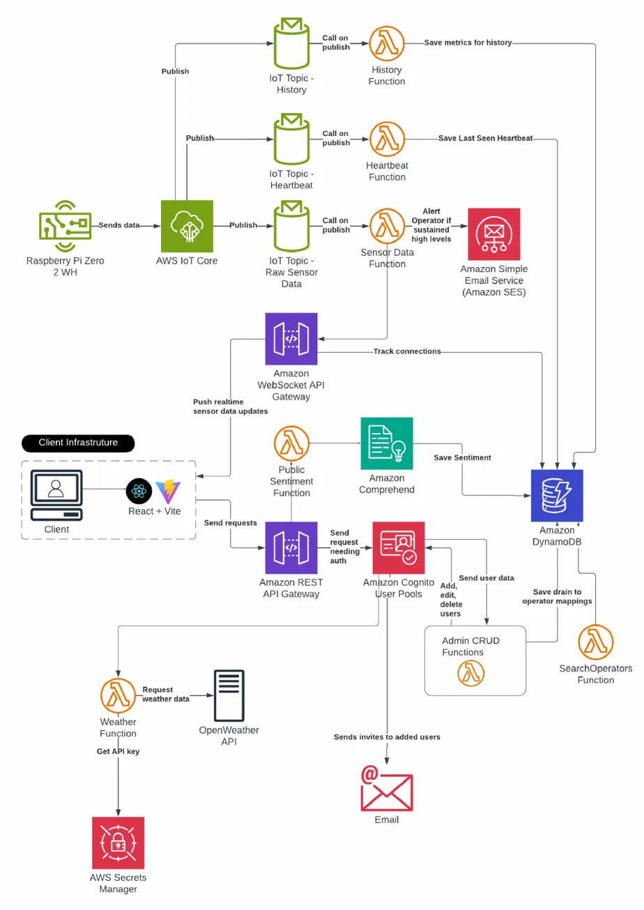
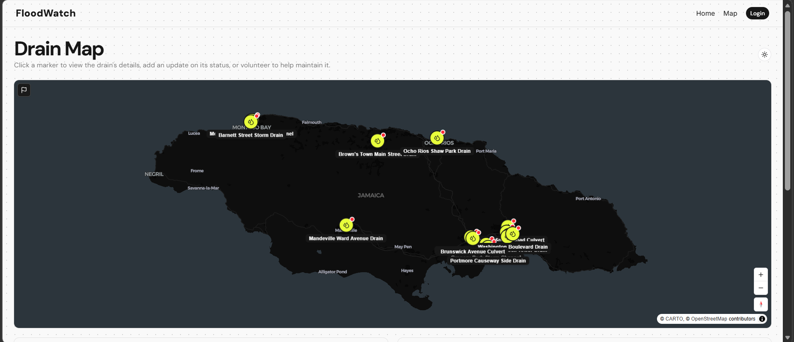
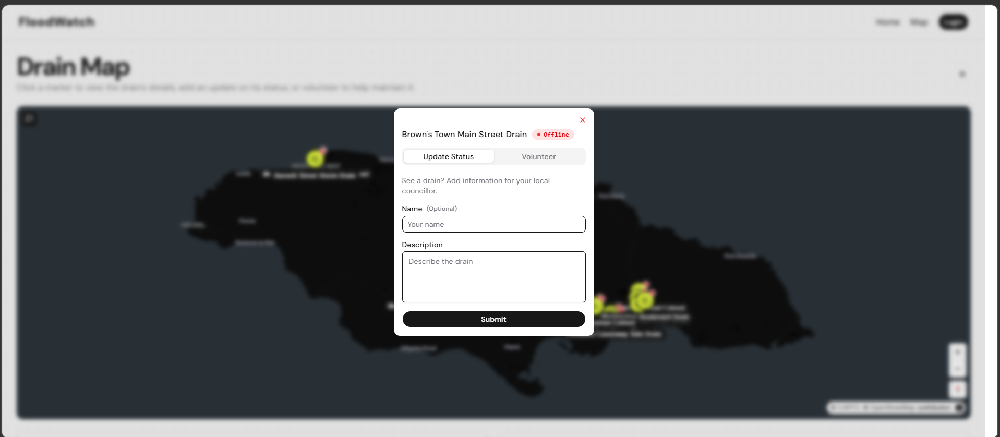
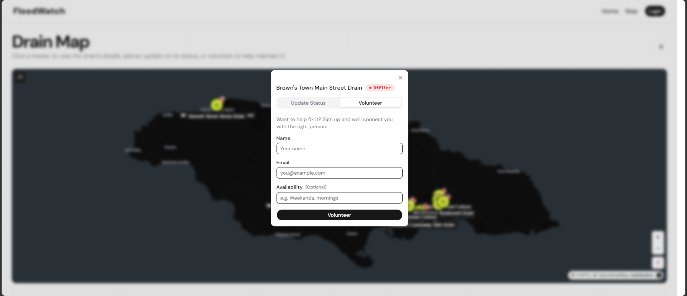
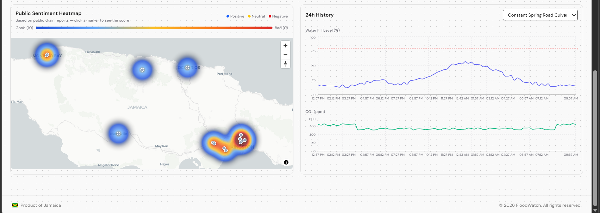
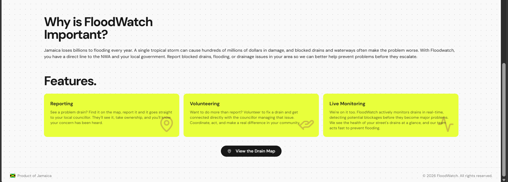

# FloodWatch

Stormwater drain monitoring and community reporting platform for Jamaica, built by a team of three at the **2026 Intellibus Hackathon**.

> **Project status:** The AWS infrastructure behind FloodWatch was decommissioned after the hackathon, so the hosted site no longer shows live data. Screenshots of the working system and the architecture are included below.

## Overview

Blocked drains make flooding worse. FloodWatch gives residents a direct line to the National Works Agency (NWA) and local government, and monitors drains so blockages can be caught before they become major problems.

## Features

- **Reporting:** Find a drain on the map, add an update on its status, and it goes to the local councillor. Reports are scored for sentiment with Amazon Comprehend.
- **Volunteering:** Sign up to help maintain a specific drain and get connected with the right person.
- **Drain monitoring:** Sensor readings (water-fill level and CO₂) are posted to the API and stored in DynamoDB, with an online/offline status per drain and 24-hour history charts.
- **Public sentiment heatmap:** Public drain reports are scored and shown as a heatmap.
- **Automated alerts:** Operators are emailed (Amazon SES) when a drain stays above 80% capacity for 10+ minutes.
- **Access control:** Amazon Cognito user pool with admin/operator groups and admin CRUD functions for managing operators.

## Architecture



*Architecture diagram from the hackathon design. The code in this repository implements sensor ingestion through REST API routes (below); the IoT Core rules and WebSocket gateway shown in the diagram are not part of this snapshot.*

**Sensor and drain data:** Devices post to the REST API (API Gateway HTTP API). Lambda functions handle each route:
- `POST /sensor-data`: updates the drain's water-fill level and sends an SES alert on sustained high levels
- `POST /heartbeat`: updates the drain's last-seen time
- `POST /history` and `GET /history/{drainId}`: store and return 24-hour metrics (DynamoDB TTL expiry)

**Public web app:** A React + Vite client calls `GET /drains`, `POST /reports` (sentiment analysis with Amazon Comprehend) and `POST /volunteers` (SES email to the operator). Operator management goes through admin CRUD routes backed by Amazon Cognito.

**Demo data:** `packages/scripts` contains seed scripts for demo drains and 24-hour history.

## Tech Stack

TypeScript, React, Vite, AWS (Lambda, DynamoDB, API Gateway, Cognito, SES, Comprehend), SST v3, Raspberry Pi Zero

## Screenshots


*Drain map showing monitored drains across Jamaica.*


*Public form for reporting a drain's status to the local councillor.*


*Volunteer sign-up for a specific drain.*


*Public sentiment heatmap and 24-hour water-fill and CO₂ history for a drain.*


*Overview of the platform's reporting, volunteering and live monitoring features.*

## Team

**Team Just Met**

| | Responsibilities |
|---|---|
| **Gabria Gordon** ([@Gabby-127](https://github.com/Gabby-127)) | History, Heartbeat and Sensor Data Lambda functions (including SES alerting), Amazon Cognito User Pools, admin CRUD functions |
| **Briony Frater** ([@BrionyFrater](https://github.com/BrionyFrater)), project lead | Search Operators, client infrastructure, public sentiment analysis (Amazon Comprehend) |
| **Sheldon** ([@SWZhang7](https://github.com/SWZhang7)) | REST API Gateway, backend review and bug fixes |

## Running It

The original AWS stack was decommissioned. To deploy your own copy you need Node.js 20+, the AWS CLI configured with credentials, and an AWS account.

```bash
npm install
cp .env.example .env              # then fill in your own values (never commit .env)
npx sst secret set SesFromEmail <your-verified-SES-email>
npm run deploy
```

Required environment variables: `OPERATOR_EMAIL`, `ADMIN_EMAIL`, `ADMIN_TEMP_PASSWORD`, `ADMIN_FIRST_NAME`, `ADMIN_LAST_NAME`. No credentials are included in this repository.
